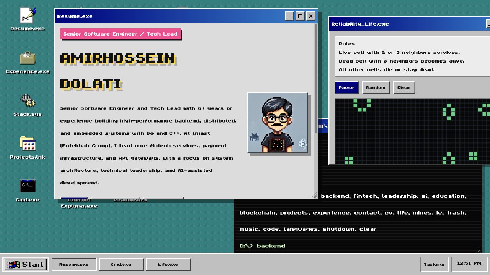
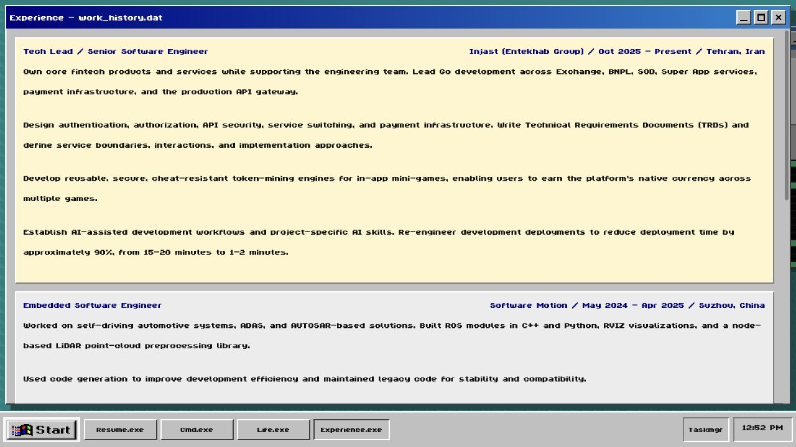
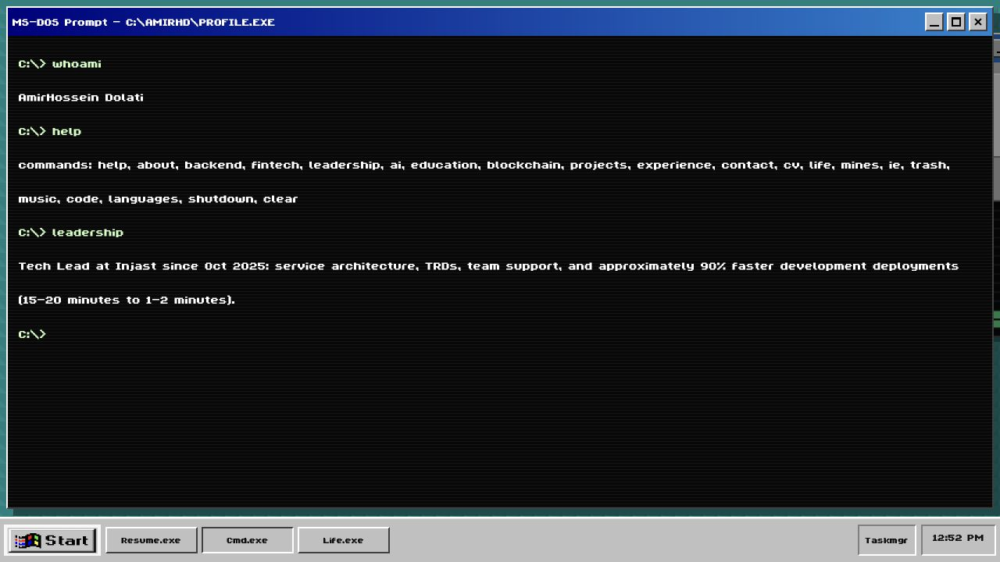
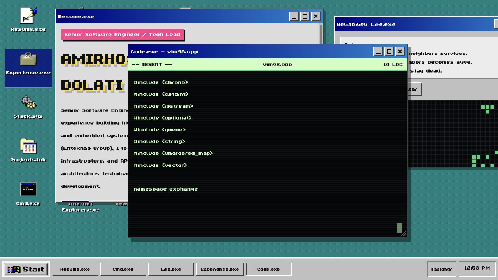
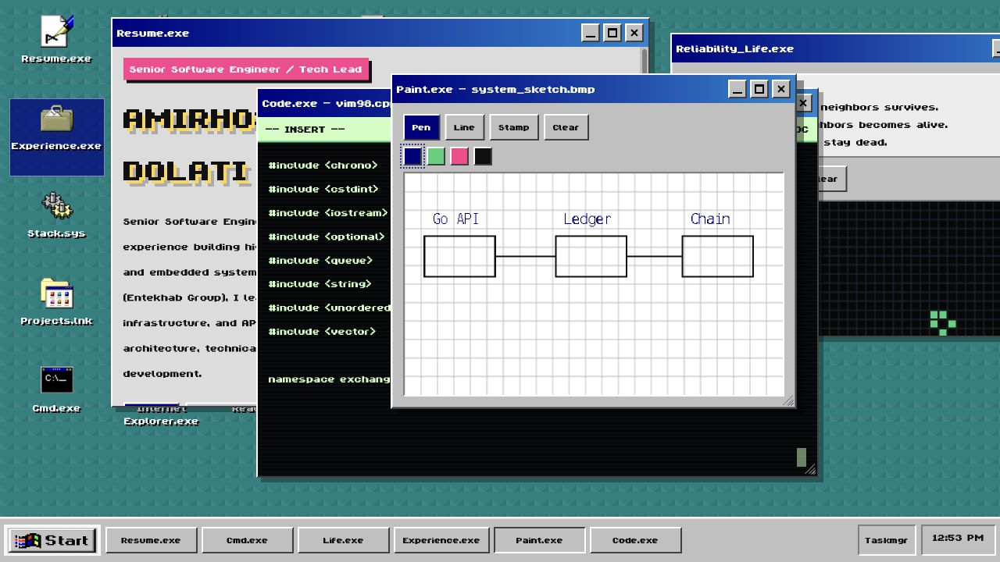
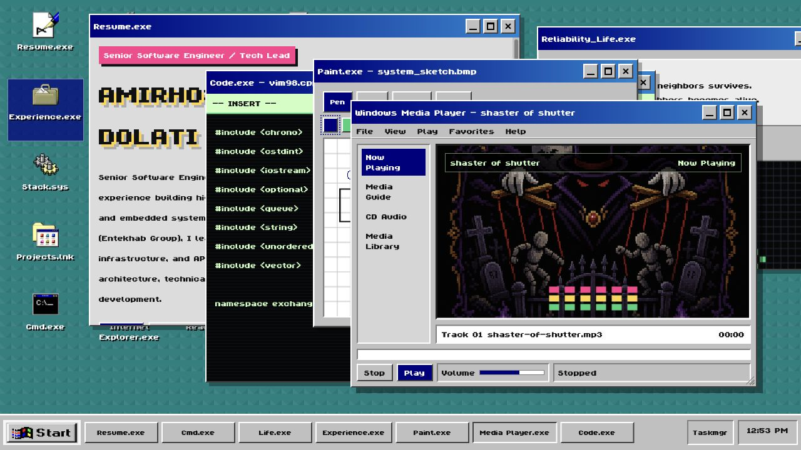
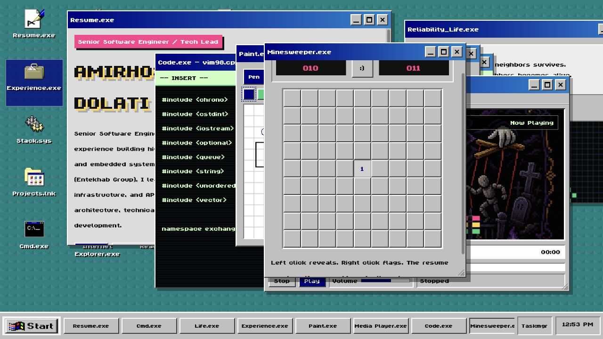

# AmirHossein Dolati Resume

A Windows 98-inspired interactive résumé for AmirHossein Dolati, Senior Software Engineer and Tech Lead. Explore professional experience, projects, and skills through a desktop full of working mini-apps.

**[Open the live website](https://amirhdolati.github.io/)** · **[Direct résumé website](https://amirhdolati.github.io/resume/)** · **[Download the latest CV](amirhossein-dolati.pdf)**



## Features

- **Desktop shell:** draggable windows, minimize/maximize/close controls, desktop shortcuts, a Start menu, a live taskbar, and a Task Manager.
- **Résumé apps:** work history, selected projects, technology stack, education, languages, contact links, and a downloadable PDF.
- **Interactive command prompt:** use `help`, `about`, `backend`, `fintech`, `leadership`, and `ai` to explore the profile; launch apps with commands such as `experience`, `education`, `music`, and `cv`.
- **Code.exe:** a playful retro editor that reveals C++ code as you type, with a live line count.
- **Paint.exe:** sketch on a canvas using a pen, lines, stamps, and color swatches.
- **Media Player:** a nostalgic music player with cover art, playback controls, volume, and progress.
- **Games and extras:** playable Minesweeper, Conway's Game of Life, a mock Internet Explorer, a recycle bin, startup sounds, a screensaver, and shutdown surprises.

## Screenshot Gallery

Click any screenshot to view it at full size. All screenshots were captured from the live website.

| Work experience | Interactive terminal |
| --- | --- |
| [](docs/screenshots/work-experience.jpg) | [](docs/screenshots/interactive-terminal.jpg) |
| Browse roles, responsibilities, and engineering achievements. | Explore the résumé and launch apps using typed commands. |

| Retro code editor | Paint canvas |
| --- | --- |
| [](docs/screenshots/retro-code-editor.jpg) | [](docs/screenshots/paint-canvas.jpg) |
| Type to reveal C++ source in a nostalgic editor. | Draw with pen, line, stamp, and color tools. |

| Media player | Minesweeper |
| --- | --- |
| [](docs/screenshots/media-player.jpg) | [](docs/screenshots/minesweeper.jpg) |
| Play music through a retro desktop interface. | Reveal cells, flag mines, and try to clear the board. |

## Updating the Resume

The website and downloadable [`amirhossein-dolati.pdf`](amirhossein-dolati.pdf) reflect the latest supplied résumé, including fintech leadership at Injast (Entekhab Group), Go and C++ engineering, AI-assisted development, and ongoing Data Science studies.

Replace `amirhossein-dolati.pdf` and keep the profile, experience, projects, stack, education, and language sections in `index.html` and the command responses in `script.js` aligned with it. Screenshots are stored in `docs/screenshots/` and can be refreshed after visual changes.

## GitHub Pages

The workflow at [`.github/workflows/jekyll-gh-pages.yml`](.github/workflows/jekyll-gh-pages.yml) builds and deploys the static site after each push to `master`. In **Settings → Pages**, the source should be set to **GitHub Actions**.

The website is published at **https://amirhdolati.github.io/resume/**. The root address, **https://amirhdolati.github.io/**, redirects here through the separate [`amirhdolati.github.io`](https://github.com/amirhdolati/amirhdolati.github.io) repository.

## Local Preview

No package installation or build step is required. Open `index.html` directly in a browser, or run a static server from the repository root:

```sh
python3 -m http.server 8000
```

Then open [http://localhost:8000](http://localhost:8000).
